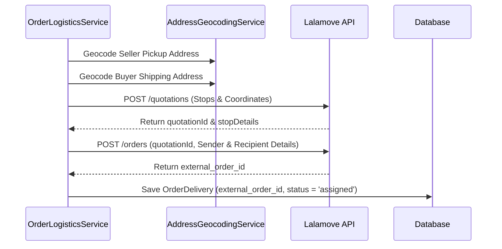

# External Integrations & Webhooks

This document outlines the operational flows, validation rules, and webhook behaviors for PayMongo (payments) and Lalamove (logistics) integrations.

---

## 1. PayMongo Payment Gateway

*   **Service Class**: [PayMongoService.php](file:///c:/laragon/www/LikhangKamay/app/Services/PayMongoService.php)
*   **Documentation Link**: [PayMongo API Reference](https://developers.paymongo.com/docs)

### Core Functions
*   `createCheckoutSession(array $data)`: Initiates a new payment session on PayMongo's server and returns the checkout session payload.
*   `retrieveCheckoutSession($sessionId)`: Resolves an active session to query payment details.

### Security & Business Constraints
1.  **Minimum Limit Constraint**: 
    > [!IMPORTANT]
    > PayMongo Checkout API has a strict minimum limit requirement of **₱100.00** (~10000 centavos). Attempting to check out transactions below this amount will fail.
2.  **Defensive Programming Wrappers**:
    All payment creation flows must be wrapped inside `try-catch` blocks to capture API execution errors cleanly without crashing the user session.
3.  **Db-Backed Status Verification**:
    Never trust raw frontend triggers or simple session identifiers. Always run a backend lookup against checkout records to verify paid states before updating order statuses to `Accepted`.

### Supported Online Payment Methods & Multi-Wallet Channels
*   **GCash**: Mapped to `gcash` in PayMongo checkout sessions.
*   **Maya**: Mapped to `paymaya` in PayMongo checkout sessions.
*   **Dynamic Source Reconciliation**:
    When a customer checks out choosing Maya or GCash, PayMongo's session dynamically returns the actual source type in `data.attributes.payments[].attributes.source.type` or `data.attributes.payment_intent.attributes.payments[].attributes.source.type`.
    - Both [PaymentController.php](file:///c:/laragon/www/LikhangKamay/app/Http/Controllers/Consumer/PaymentController.php) and [PaymongoWebhookController.php](file:///c:/laragon/www/LikhangKamay/app/Http/Controllers/Webhooks/PaymongoWebhookController.php) inspect this telemetry.
    - If a user selected Maya at checkout but completed payment via GCash (or vice-versa in test/production gateway environments), `orders.payment_method` is automatically reconciled to reflect the true wallet provider (`Maya`, `GCash`, `Card`).
    - [GetBuyerOrders.php](file:///c:/laragon/www/LikhangKamay/app/Actions/Consumer/GetBuyerOrders.php) also applies this reconciliation when resolving lingering pending sessions upon viewing `/my-orders`.

### Webhook & Signature Verification
*   **Webhook Controller**: [PaymongoWebhookController.php](file:///c:/laragon/www/LikhangKamay/app/Http/Controllers/Webhooks/PaymongoWebhookController.php)
*   **Endpoint Route**: POST `/webhooks/paymongo` (exempt from CSRF in `bootstrap/app.php`).
*   **Signature Security**:
    > [!IMPORTANT]
### Integration & Regression Suites
*   [MayaPaymentIntegrationTest.php](file:///c:/laragon/www/LikhangKamay/tests/Feature/Payments/MayaPaymentIntegrationTest.php): Tests end-to-end Maya checkout, session generation, webhook handling, and dynamic source reconciliation.
*   [PaymongoWebhookSignatureTest.php](file:///c:/laragon/www/LikhangKamay/tests/Feature/Payments/PaymongoWebhookSignatureTest.php): Tests HMAC signature verification and attack payload rejection.
*   [PaymentConvenienceFeeTest.php](file:///c:/laragon/www/LikhangKamay/tests/Feature/Payments/PaymentConvenienceFeeTest.php): Tests online payment convenience fee computation and guest session handling.

---

## 2. Lalamove Delivery Service

*   **Service Class**: [LalamoveService.php](file:///c:/laragon/www/LikhangKamay/app/Services/LalamoveService.php)
*   **Logistics Coordinator**: [OrderLogisticsService.php](file:///c:/laragon/www/LikhangKamay/app/Services/OrderLogisticsService.php)

### Delivery Booking Lifecycle

### Key Validation & Optimization Checks
*   **Method Check**: Lalamove is exclusively utilized for orders where `shipping_method === 'Delivery'`. Pickup/COD-only orders bypass this flow.
*   **State Check**: Only orders currently marked as `Accepted` (after payment confirmation) can be booked with Lalamove.
*   **Junction Check**: The buyer and seller address coordinate checks are geocoded using [AddressGeocodingService.php](file:///c:/laragon/www/LikhangKamay/app/Services/AddressGeocodingService.php) (Nominatim API). The system fails if both coordinates resolve to the same point.
*   **Double Geocoding Prevention**:
    In the event of a Lalamove API quotation or driver booking failure, the fallback geocoder in [CheckoutShippingService.php](file:///c:/laragon/www/LikhangKamay/app/Services/CheckoutShippingService.php) reuses any coordinates already fetched rather than making redundant Nominatim requests. This preserves OpenStreetMap API usage thresholds.
*   **Asynchronous Dashboard Status Sync**:
    To avoid 504 serverless function execution timeouts during dashboard loading, active shipment polling is deferred to the background queue via [SyncOrderDeliveryJob.php](file:///c:/laragon/www/LikhangKamay/app/Jobs/SyncOrderDeliveryJob.php).

---

## 3. Lalamove Webhook Receiver

*   **Webhook Controller**: [LalamoveWebhookController.php](file:///c:/laragon/www/LikhangKamay/app/Http/Controllers/Webhooks/LalamoveWebhookController.php)
*   **Endpoint Route**: Post route defined in [web.php](file:///c:/laragon/www/LikhangKamay/routes/web.php) (exempt from CSRF verification in [app.php](file:///c:/laragon/www/LikhangKamay/bootstrap/app.php)).

### Security Validation
*   Validates the incoming query string parameter `token` against the application's configured secret:
    `config('services.lalamove.webhook_secret')`
*   Rejects requests with a `419` / `401 Unauthorized` response if the token is missing or incorrect.

### Fault Tolerance
If the webhook processing throws a server-side exception (e.g., database lock or temporary service failure), the controller catches the error, logs it, and returns a standard `200 OK` response.
> [!NOTE]
> Returning `200 OK` on processing failure is intentional. It prevents the Lalamove server from initiating infinite webhook payload retries, which would flood the system logs.

---

## 4. Production Webhooks & Maintenance

### Migration Webhook (`/webhooks/migrate`)
*   **Route**: `GET /webhooks/migrate` (defined in [web.php](file:///c:/laragon/www/LikhangKamay/routes/web.php)).
*   **Purpose**: Allows running `php artisan migrate --force` securely on serverless host environments (such as Vercel).
*   **Authorization Modes**:
    1. Query secret matching `CRON_SECRET` environment variable (`?secret=<CRON_SECRET>`).
    2. Authenticated `super_admin` or `artisan` user session.
    3. Emergency migration key parameter (`?secret=likhangkamay_migrate_2026`).
*   **Response Format**: Returns JSON payload with migration output and structured error reports.
*   **Settings Cache Invalidation**: Automatically flushes `all_platform_settings`, `system_settings_all`, and `setting_contact_info` from cache upon execution, ensuring zero-downtime propagation of newly seeded or migrated platform variables (such as official support email `likhangkamaybusiness@gmail.com`) to frontend Inertia shared props.

### Background Queue Worker Webhook (`/webhooks/cron/queue`)
*   **Route**: `GET /webhooks/cron/queue` (defined in [web.php](file:///c:/laragon/www/LikhangKamay/routes/web.php)).
*   **Security Header**: Validates `X-Vercel-Cron-Secret` against `CRON_SECRET`.
*   **Execution**: Dispatches `queue:work --stop-when-empty --max-time=50` to process queued notifications, mailings, and async tasks without blocking HTTP serverless requests.

---

## 5. Real-Time Synchronization & Resilient Fallbacks

LikhangKamay uses a dual-layer real-time architecture to deliver live updates seamlessly across both local (Laragon/MySQL) and production (Vercel serverless / PostgreSQL).

### Client Hook & Component Topology
*   **Global Listener**: [useRealtime.js](file:///c:/laragon/www/LikhangKamay/resources/js/hooks/useRealtime.js) (included in `AuthenticatedLayout`, `AdminLayout`, and `BuyerNavbar`).
*   **Chat Hook**: [useEchoConnection.js](file:///c:/laragon/www/LikhangKamay/resources/js/hooks/useEchoConnection.js), [useTeamChatEcho.js](file:///c:/laragon/www/LikhangKamay/resources/js/hooks/useTeamChatEcho.js).

### Protocol & Fallback Strategy
1.  **Primary Channel (Supabase & WebSockets)**:
    *   Listens for `postgres_changes` on the `notifications` and `orders` tables.
    *   Listens for private chat broadcasts via Laravel Echo (`chat.{id}`, `team-chat.{id}`).
2.  **Adaptive Polling Fallback ([useRealtime.js](file:///c:/laragon/www/LikhangKamay/resources/js/hooks/useRealtime.js))**:
    *   If Supabase or Echo WebSockets disconnect, the client automatically starts recursive fallback polling.
    *   **In-Flight Mutex Guard**: Uses `isReloadingRef` to ensure an unresolved slow reload skips subsequent ticks, preventing HTTP request stacking on high-latency links.
    *   **Adaptive Cadence**: 5 seconds on normal connections; dynamically backs off to **18 seconds** when network degradation is detected (`isDegraded === true` from [useNetworkStatus.js](file:///c:/laragon/www/LikhangKamay/resources/js/hooks/useNetworkStatus.js)).
    *   **Background Tab Sleep**: Completely suspends polling when `document.hidden === true` or offline to preserve mobile battery and prevent lambda exhaustion.
3.  **Instant Window Focus Synchronization**:
    *   Whenever the user refocuses the window or switches back to the browser tab (`visibilitychange` / `focus`), an immediate sync request updates notification badges and counters without page refreshes, and resumes fallback polling if disconnected.
4.  **Courier Tracking Polling ([useOrderPolling.js](file:///c:/laragon/www/LikhangKamay/resources/js/hooks/useOrderPolling.js))**:
    *   Active delivery tracking periodically queries order state (15s cadence) with in-flight lock protection.
    *   Sleeps during background tab state and immediately refreshes on tab refocus.
5.  **Cross-Database JSON Compatibility**:
    *   The `notifications.data` column uses native `jsonb` on PostgreSQL and `json` on MySQL, allowing robust JSON path filters (`data->sender_id`) without syntax errors.

---

## 6. Client Transport Resilience & Prefetching Strategy

To safeguard user experience and prevent data loss over high-latency or metered cellular networks in Philippine provinces, LikhangKamay enforces a resilient client transport policy.

### Axios Request Timeout & Idempotent GET Retry
*   **Target File**: [bootstrap.js](file:///c:/laragon/www/LikhangKamay/resources/js/bootstrap.js)
*   **Request Timeout**: Configured at `window.axios.defaults.timeout = 12000` (12 seconds), keeping client execution safely below Vercel's 15-second serverless execution ceiling.
*   **Idempotent Retry Policy**:
    *   **Scope**: Strictly restricted to idempotent `GET` requests (`config.method.toLowerCase() === 'get'`). Mutating verbs (`POST`, `PUT`, `PATCH`, `DELETE`) are **never retried** to guarantee absolute protection against duplicate orders, double payments, or duplicate stock movements.
    *   **Cancellation Safety**: Aborted requests (`axios.isCancel(error)` or `config.signal.aborted`) reject immediately without retry, preventing unmount leaks.
    *   **Transient Error Interception**: Automatically catches `ECONNABORTED` (timeout), `ERR_NETWORK`, socket drops (`!response`), and gateway errors (`502`, `503`, `504`).
    *   **Backoff Schedule**: Maximum of 2 retries (total 3 attempts) using jittered exponential backoff:
        $$\text{delay} = 1000 \times 1.5^{\text{attempt} - 1} + \text{jitter}(0..350\text{ms})$$
    *   **Degradation Notification**: On transient drops, dispatches `window.dispatchEvent(new CustomEvent('network-degraded'))`, seamlessly coordinating with UI components and `useRealtime`.

### Conditional Link Hover Prefetching
*   **Target Hook**: [useNetworkStatus.js](file:///c:/laragon/www/LikhangKamay/resources/js/hooks/useNetworkStatus.js)
*   **Singleton Reactive Store**: Uses React 18 `useSyncExternalStore` with a module-level singleton subscriber to eliminate duplicate event listeners across hundreds of mounted components.
*   **Prefetch Evaluation**:
    *   `canPrefetch = isOnline && !isDegraded && !saveData`
    *   Detects cellular Data Saver mode (`navigator.connection.saveData`) and slow 2G cellular bands (`navigator.connection.effectiveType === 'slow-2g' || '2g'`).
    *   Subscribes to browser `online`, `offline`, `network-degraded`, and Network Information `change` events.
*   **Protected UI Call-Sites**:
    *   **Buyer Header**: [BuyerNavbar.jsx](file:///c:/laragon/www/LikhangKamay/resources/js/Layouts/BuyerNavbar.jsx) conditionally prefetches login/register links.
    *   **Seller Sidebar**: [NavItem.jsx](file:///c:/laragon/www/LikhangKamay/resources/js/Components/Seller/Sidebar/NavItem.jsx) dynamically gates dashboard route prefetching.
    *   **Admin Console**: [AdminLayout.jsx](file:///c:/laragon/www/LikhangKamay/resources/js/Layouts/AdminLayout.jsx) conditionally prefetches admin workspace modules.
    *   **Shop Catalog**: [ProductCard.jsx](file:///c:/laragon/www/LikhangKamay/resources/js/Pages/Consumer/Shop/Partials/ProductCard.jsx) dynamically disables hover page prefetching on cellular/slow links, preserving user data quotas while preserving instant navigation on broadband desktop.

---

## 7. Static Asset Shell & 3D Compression Pipeline

To support reliable offline fallback and accelerate heavy 3D craft model loading over provincial 3G/4G connections, LikhangKamay implements a lightweight Service Worker static shell and a native Draco/KTX2 asset decompression pipeline.

### Lightweight Service Worker Shell ([public/sw.js](file:///c:/laragon/www/LikhangKamay/public/sw.js))
*   **Target Scope**: Root scope (`/`) with strict production gating (`import.meta.env.PROD` in [resources/js/app.jsx](file:///c:/laragon/www/LikhangKamay/resources/js/app.jsx)).
*   **Cache Strategy**:
    *   **Cache-First**: Applied to immutable hashed Vite bundles (`/build/assets/*`), local Draco decoder binaries (`/draco/*`), static illustrations/images (`/images/*`), and demo models (`/models/*`).
    *   **Pre-cached Fallbacks**: Automatically pre-caches `/images/placeholder.svg`, `/images/no-image.png`, `/favicon.ico`, and Draco WebAssembly binaries on worker installation.
    *   **Image Offline Fallback**: In the event of a network drop when loading non-cached secondary images, intercepts the error and returns the cached `/images/placeholder.svg`.
*   **Critical Safety Guards (Zero-Stale-HTML Guarantee)**:
    *   **Inertia State Protection**: All requests containing header `X-Inertia: true` or requesting HTML navigation (`mode === 'navigate'`) completely bypass the Service Worker cache. This ensures session-bound CSRF tokens and page props are never poisoned by stale cached HTML.
    *   **Dynamic API Exclusion**: Strict network bypass for `/api/*`, `/webhooks/*`, `/sanctum/*`, `/broadcasting/*`, `/auth/*`, `/login`, `/logout`, `/register`, and `/ping`.
    *   **Mutating Request Safety**: Non-GET requests (`POST`, `PUT`, `DELETE`, `PATCH`) bypass the worker unconditionally.
*   **Edge CDN Cache-Control ([vercel.json](file:///c:/laragon/www/LikhangKamay/vercel.json))**:
    *   `/sw.js`: Configured with `cache-control: public, max-age=0, must-revalidate` and `Service-Worker-Allowed: /` to prevent browser caching of the worker script.
    *   `/draco/(.*)`: Configured with `cache-control: public, max-age=31536000, immutable` for 1-year edge CDN caching.

### 3D Compression Pipeline ([threeLoaders.js](file:///c:/laragon/www/LikhangKamay/resources/js/Components/ThreeD/threeLoaders.js), [GLTFModel.jsx](file:///c:/laragon/www/LikhangKamay/resources/js/Components/ThreeD/GLTFModel.jsx))
*   **Draco Mesh Decompression**:
    *   Hosted static binaries located at [public/draco/gltf/](file:///c:/laragon/www/LikhangKamay/public/draco/gltf/) (`draco_decoder.wasm`, `draco_decoder_gltf.wasm`, `draco_decoder.js`, `draco_wasm_wrapper.js`) avoid cross-origin roundtrips and enable offline mesh parsing.
    *   Managed by module singleton `getSharedDRACOLoader(dracoPath)` in `threeLoaders.js`, attaching seamlessly to any standard Three.js `GLTFLoader` or `@react-three/drei` loader without manual setup.
    *   Standard fallback route to Google CDN (`https://www.gstatic.com/draco/versioned/decoders/1.5.7/`).
    *   Reduces 3D mesh geometry data payload by **60% to 80%**, saving mobile megabytes.
*   **KTX2 Basis Texture Transcoding**:
    *   Managed by module singleton `getSharedKTX2Loader(gl)`, preventing worker pool proliferation across simultaneous viewer instances.
    *   Configures transcoding via pmndrs basis transcoder CDN (`https://cdn.jsdelivr.net/gh/pmndrs/drei-assets@master/basis/`).
    *   Detects WebGL GPU compressed texture extensions (ASTC, ETC2, DXT, BPTC, PVRTC) via `ktx2Loader.detectSupport(gl)` for zero-overhead direct VRAM uploading.
*   **Viewer Fallback & Preloading**:
    *   Exported `preloadProduct3D(url)` in [ProductViewer3D.jsx](file:///c:/laragon/www/LikhangKamay/resources/js/Components/ThreeD/ProductViewer3D.jsx) enables speculative preloading on high-speed connections.
    *   [ThreeDModelBoundary.jsx](file:///c:/laragon/www/LikhangKamay/resources/js/Components/ThreeD/ThreeDModelBoundary.jsx) catches malformed models or network connection drops, providing an interactive retry button without unmounting parent components.
