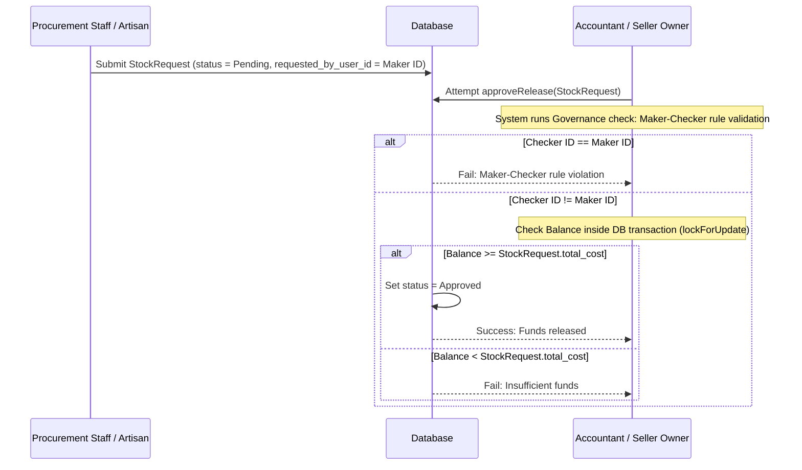

# ERP: Procurement & Inventory

This document outlines the workflows, schemas, and governance controls for restocking and managing inventory supplies.

---

## 1. Core Domain Models

*   **Supply Model**: [Supply.php](file:///c:/laragon/www/LikhangKamay/app/Models/Supply.php)
    *   Tracks physical raw materials (e.g., clay, glazes, tools) needed for ceramic production.
    *   Fields: `name`, `sku`, `category`, `stock` (available volume), `unit`, `unit_cost`, `reorder_level`.
*   **Stock Request Model**: [StockRequest.php](file:///c:/laragon/www/LikhangKamay/app/Models/StockRequest.php)
    *   Represents a formal request to purchase/restock raw supplies.
    *   Fields: `supply_id`, `requested_by_user_id`, `quantity`, `total_cost`, `status`, `rejection_reason`.
    *   Status constants:
        *   `STATUS_PENDING = 'Pending'`
        *   `STATUS_ACCOUNTING_APPROVED = 'Approved'`
        *   `STATUS_ORDERED = 'Ordered'`
        *   `STATUS_PARTIALLY_RECEIVED = 'Partially Received'`
        *   `STATUS_RECEIVED = 'Received'`
        *   `STATUS_COMPLETED = 'Completed'`
        *   `STATUS_REJECTED = 'Rejected'`
*   **Product Recipe Model**: [ProductRecipe.php](file:///c:/laragon/www/LikhangKamay/app/Models/ProductRecipe.php)
    *   Defines the raw materials (`Supply` items) and quantities required to produce one unit of a finished `Product`.
    *   Establishes the costing linkage where total recipe costs directly influence a product's base `cost_price`.

---

## 2. Procurement & Approval Lifecycle

The procurement flow relies on a strict maker-checker approval separation.



---

## 3. Governance: The Maker-Checker Rule

Implemented in [AccountingController.php](file:///c:/laragon/www/LikhangKamay/app/Http/Controllers/Seller/AccountingController.php):
```php
$actor = $this->sellerActor();
if ($stockRequest->requested_by_user_id && $stockRequest->requested_by_user_id === $actor->id) {
    return back()->with('error', 'Governance Control: Maker-Checker rule violation. You cannot approve a request you initiated.');
}
```
*   **Maker (Initiator)**: The staff member or artisan who creates the stock request.
*   **Checker (Approver)**: A separate accountant or the seller owner who reviews and releases the funds.
*   **Audit Notification**: When a request is rejected, the maker is notified via `AccountingRejectedNotification`.

---

## 4. Supply Catalog Interfaces

*   **Add Supply Modal**: [`AddSupplyModal.jsx`](file:///c:/laragon/www/LikhangKamay/resources/js/Components/Seller/Procurement/AddSupplyModal.jsx)
    *   Provides material registration with automated SKU generation, live uniqueness constraint checks, alert threshold configurations (`min_stock`, `max_stock`), and instant batch valuation calculation (`quantity * unit_cost`).
*   **Edit Supply Modal**: [`EditSupplyModal.jsx`](file:///c:/laragon/www/LikhangKamay/resources/js/Components/Seller/Procurement/EditSupplyModal.jsx)
    *   Enforces locked catalog code protection while enabling inventory managers to adjust reorder levels, unit costs, vendor sourcing, and storage specifications.

---

## 5. Bill of Materials (BOM) Automated Deduction & Concurrency Controls

Automated through [`BOMDeductionService.php`](file:///c:/laragon/www/LikhangKamay/app/Services/BOMDeductionService.php):

*   **Order Processing Trigger**: When an order transitions to `Processing`, raw material recipes tied to manufactured catalog items are aggregated and verified against live supply balances.
*   **Pessimistic Concurrency Locks (`lockForUpdate`)**: Supply IDs are deterministically sorted (`sort($supplyIds)`) and acquired via `Supply::query()->whereIn('id', $supplyIds)->lockForUpdate()` inside `DB::transaction()` to prevent database deadlocks and race condition quantity overwrite traps under concurrent order acceptance.
*   **Threshold Trigger**: If deducted supplies reach or fall below their configured `min_stock` threshold, the service auto-generates a draft [`StockRequest`](file:///c:/laragon/www/LikhangKamay/app/Models/StockRequest.php) for the workshop owner.
*   **Cancellation Restoration**: If an order in `Processing` or `Ready for Pickup` is cancelled or rejected, `restoreForOrder()` acquires sorted row locks and restores the exact deducted raw supply quantities.

---

## 6. B2B Supply Hub & Peer Artisan Wholesale Access

Governed by [ProductPolicy.php](file:///c:/laragon/www/LikhangKamay/app/Policies/ProductPolicy.php) and [ProductController.php](file:///c:/laragon/www/LikhangKamay/app/Http/Controllers/Seller/ProductController.php):

*   **Catalog Segregation**: Products flagged as raw material wholesale supplies (`is_b2b_supply = true`) are segregated from consumer retail feeds.
*   **Access Clearance**: Peer artisans with Supply Hub privileges (`canAccessSupplyHub()`) are authorized to inspect product detail pages (`/product/{id}`) and purchase inventory in bulk above the Minimum Order Quantity (MOQ).
*   **Retail Protection**: Unauthenticated guests and standard consumer accounts attempting to visit wholesale raw material listings are issued an immediate `404 Not Found` response, ensuring B2B catalog isolation.
*   **Wholesale Sales & Sourcing Management**: [B2BSupplyHubController.php](file:///c:/laragon/www/LikhangKamay/app/Http/Controllers/Seller/B2BSupplyHubController.php) controls peer-to-peer raw material transactions. Sourcing orders (`/supply-hub/orders`) and wholesale sales (`/supply-hub/sales`) provide dedicated status pipelines (`pending`, `processing`, `shipped`, `delivered`, `completed`, `cancelled`).
*   **Horizontal Scroll Hitbox Isolation**: Segmented status toolbars across Supply Hub and Seller workspaces utilize [`useIsolatedHorizontalScroll.js`](file:///c:/laragon/www/LikhangKamay/resources/js/hooks/useIsolatedHorizontalScroll.js) to intercept non-passive wheel events, enabling fluid horizontal navigation while preventing window/screen scrolling leaks.

---

## 7. Inward Goods Receiving & Inventory Synchronization

Governed by [StockRequestController.php](file:///c:/laragon/www/LikhangKamay/app/Http/Controllers/Seller/StockRequestController.php):

*   **Status Precondition**: Inward goods receiving (`POST /procurement/stock-requests/{stockRequest}/receive`) enforces strict lifecycle validation. Only stock requests in `accounting_approved`, `ordered`, `partially_received`, or `received` states are eligible for inventory intake. Unapproved or pending requests return an immediate graceful warning redirect to protect inventory balances from unauthorized or unreleased intake.
*   **Inventory Synchronization**: When `sync_inventory = true`, inward shipments automatically increment the active [`Supply`](file:///c:/laragon/www/LikhangKamay/app/Models/Supply.php) balance under row-level pessimistic locks (`lockForUpdate()`), updating the linked finished product's stock count.

