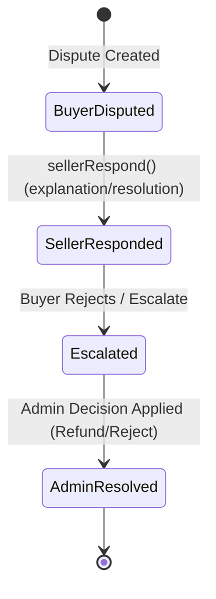

# Moderation & Disputes

This document outlines the content moderation workflow, order disputes, review reports, and administrator resolution pipelines.

---

## 1. Domain Models

*   **Dispute Model**: [Dispute.php](file:///c:/laragon/www/LikhangKamay/app/Models/Dispute.php)
    *   Tracks formal complaints raised by buyers regarding order delivery, item quality, or incorrect charges.
    *   Fields: `order_id`, `status`, `reason`, `proof_photos` (JSON array of image paths), `platform_policy_id`, `policy_version`, `damage_reason_code`, `criteria_checklist`, `photo_angles`, `seller_response_type`, `seller_explanation`, `seller_proposed_description`, `escalation_reason`, `admin_notes`, `admin_decision`, `resolved_at`.
*   **Dynamic Platform Policy & Consent Models**: [PlatformPolicy.php](file:///c:/laragon/www/LikhangKamay/app/Models/PlatformPolicy.php) & [UserPolicyConsent.php](file:///c:/laragon/www/LikhangKamay/app/Models/UserPolicyConsent.php)
    *   Store versioned legal policies (`return_refund_policy`, `terms_of_service`, `privacy_policy`, `seller_agreement`, `seller_privacy`), structured return criteria (`return_window_hours`, `max_photos`, `eligible_reasons`, `mandatory_photo_angles`, `checklist_items`), and auditable user consent snapshots.
*   **Review Dispute**: [ReviewDispute.php](file:///c:/laragon/www/LikhangKamay/app/Models/ReviewDispute.php)
    *   Tracks complaints filed by sellers to report abusive, fraudulent, or off-topic product reviews (supports Soft Deletes and moderation withdrawal).
    *   Fields: `review_id`, `seller_id`, `seller_owner_id`, `reported_by_user_id`, `status` (Pending, Resolved, Rejected), `reason`, `explanation`, `resolved_at`, `resolution_notes`.
*   **Flagged Content**: [FlaggedContent.php](file:///c:/laragon/www/LikhangKamay/app/Models/FlaggedContent.php)
    *   Polymorphic reports tracking flagged products, descriptions, reviews, or user accounts.
    *   Fields: `reporter_id`, `reportable_type` (polymorphic class reference), `reportable_id`, `reason`, `status` (Pending, Resolved), `resolved_by`, `resolved_at`.

---

## 2. Order Disputes Flow

Order disputes arise when a buyer is unsatisfied with a delivery or product.

### Action Controls
1.  **Response State**:
    The seller can respond using `sellerRespond()` inside [DisputeController.php](file:///c:/laragon/www/LikhangKamay/app/Http/Controllers/Core/DisputeController.php), submitting a proposed resolution and explanation.
2.  **Refund Escalation**:
    If unresolved, disputes can be escalated. The super admin makes the final binding decision (`admin_decision` = Approved/Refunded or Rejected).
3.  **Dispute Evidence Comparison & Dossier**:
    Admins inspect disputes via [DisputeEscalationDashboard.jsx](file:///c:/laragon/www/LikhangKamay/resources/js/Pages/Admin/Disputes/DisputeEscalationDashboard.jsx) and [DisputeInspectorContent.jsx](file:///c:/laragon/www/LikhangKamay/resources/js/Components/Admin/Disputes/DisputeInspectorContent.jsx). [DisputeController.php](file:///c:/laragon/www/LikhangKamay/app/Http/Controllers/Core/DisputeController.php) resolves `proof_photos`, `photo_angles`, `proof_of_delivery`, and item images through [StorageUrl.php](file:///c:/laragon/www/LikhangKamay/app/Services/StorageUrl.php), and [DisputeInspectorContent.jsx](file:///c:/laragon/www/LikhangKamay/resources/js/Components/Admin/Disputes/DisputeInspectorContent.jsx) distinguishes confirmed vs unconfirmed `criteria_checklist` entries.
    - **Split Queue Layout:** Left side lists tickets filtered by pills (`All`, `Escalated`, `In Progress`, `Resolved`) with search and counts; right side mounts the case inspector.
    - **Visual Diff Inspection:** [ImageDiffSlider.jsx](file:///c:/laragon/www/LikhangKamay/resources/js/Components/Common/ImageDiffSlider.jsx) provides interactive side-by-side surface comparisons between artisan pre-shipment/catalog reference photos and buyer defect proof photos.
    - **Dual Dossier:** Displays side-by-side claim boxes (customer claim notes vs shop response) with full multi-photo lightbox viewing via [DisputeLightboxModal.jsx](file:///c:/laragon/www/LikhangKamay/resources/js/Components/Admin/Disputes/DisputeLightboxModal.jsx).
    - **Structured Buyer Return Gating:** [ReturnRequestModal.jsx](file:///c:/laragon/www/LikhangKamay/resources/js/Components/Consumer/Buyer/MyOrders/ReturnRequestModal.jsx), [ReturnCriteriaFields.jsx](file:///c:/laragon/www/LikhangKamay/resources/js/Components/Consumer/Buyer/MyOrders/ReturnCriteriaFields.jsx), [ReturnPhotoAngleSlots.jsx](file:///c:/laragon/www/LikhangKamay/resources/js/Components/Consumer/Buyer/MyOrders/ReturnPhotoAngleSlots.jsx), and [useReturnPhotoSlots.js](file:///c:/laragon/www/LikhangKamay/resources/js/Components/Consumer/Buyer/MyOrders/useReturnPhotoSlots.js) enforce the active return policy criteria and 4MB aggregate payload limit without duplicating proof files in `transform()`, while [PolicyService.php](file:///c:/laragon/www/LikhangKamay/app/Services/PolicyService.php) validates criteria before S3 uploads in [BuyerInitiateDispute.php](file:///c:/laragon/www/LikhangKamay/app/Actions/Disputes/BuyerInitiateDispute.php) and [RequestOrderReturn.php](file:///c:/laragon/www/LikhangKamay/app/Actions/Consumer/RequestOrderReturn.php) and records consent outside `DB::transaction()`.
    - **Arbitration Actions:** Single-row decision controls with plain-language terms: `Decline (Pay Shop)`, `50% Refund`, and `Approve Refund` with confirmation modals via [ArbitrationConfirmModal.jsx](file:///c:/laragon/www/LikhangKamay/resources/js/Components/Admin/Disputes/ArbitrationConfirmModal.jsx).
    - **50% Partial Refund Settlement:** When a 50% split is ruled, [AdminArbitrateDispute.php](file:///c:/laragon/www/LikhangKamay/app/Actions/Disputes/AdminArbitrateDispute.php) sets the order status to `Completed` with `payment_status = 'partially_refunded'` and updates `seller_net_amount` to 50%. This commits the 50% refund to the buyer via PayMongo while accurately preserving the remaining 50% in the artisan's accounting revenue and withdrawable payout balance in [AccountingLedgerService.php](file:///c:/laragon/www/LikhangKamay/app/Services/AccountingLedgerService.php).
4.  **Soft-Deleted & Inactive Seller Defensive Scoping**:
    Dispute and post-purchase resolution actions ([BuyerInitiateDispute.php](file:///c:/laragon/www/LikhangKamay/app/Actions/Disputes/BuyerInitiateDispute.php), [BuyerReactToDispute.php](file:///c:/laragon/www/LikhangKamay/app/Actions/Disputes/BuyerReactToDispute.php), [AdminArbitrateDispute.php](file:///c:/laragon/www/LikhangKamay/app/Actions/Disputes/AdminArbitrateDispute.php), [RequestOrderReturn.php](file:///c:/laragon/www/LikhangKamay/app/Actions/Consumer/RequestOrderReturn.php), [ApproveOrderReplacement.php](file:///c:/laragon/www/LikhangKamay/app/Actions/Seller/Orders/ApproveOrderReplacement.php)) query seller and buyer models using `User::withTrashed()->find()`. This guarantees that if a shop owner account has been deactivated or soft-deleted following an order, return notifications, activity audits, and replacement courier re-booking execute resiliently without null reference exceptions.

---

## 3. Review Moderation Queue

Managed in [ModerationController.php](file:///c:/laragon/www/LikhangKamay/app/Http/Controllers/Admin/ModerationController.php):

*   **Review Flagging**: Sellers or other users can flag bad/inappropriate reviews.
*   **Administrative Actions**:
    *   **Hide from Marketplace**: The super admin can approve the review dispute, marking the review as hidden from the marketplace.
*   **Hidden Reviews Restrictions**: Reviews marked as hidden are disabled and cannot be pinned to the top of the product page by the seller.
*   **Consumer Review Submission**: [ReviewController.php](file:///c:/laragon/www/LikhangKamay/app/Http/Controllers/Consumer/ReviewController.php) allows buyers to publish product feedback and ratings, validated via [StoreReviewRequest.php](file:///c:/laragon/www/LikhangKamay/app/Http/Requests/Consumer/StoreReviewRequest.php) and [UpdateReviewRequest.php](file:///c:/laragon/www/LikhangKamay/app/Http/Requests/Consumer/UpdateReviewRequest.php).
*   **Seller Review Desk**: [ReviewController.php](file:///c:/laragon/www/LikhangKamay/app/Http/Controllers/Seller/ReviewController.php) manages incoming product reviews, replies, dispute escalations, and review pinning. Queries enforce PostgreSQL dual-DB typing parity with qualified column ordering (`products.reviews_count`) and null-safe timestamp formatting.

### Core Business Actions
*   [BuyerInitiateDispute.php](file:///c:/laragon/www/LikhangKamay/app/Actions/Disputes/BuyerInitiateDispute.php): Validates and creates a new dispute entry for a completed order.
*   [SellerRespondToDispute.php](file:///c:/laragon/www/LikhangKamay/app/Actions/Disputes/SellerRespondToDispute.php): Saves the seller's explanation, proposed remedy, or refund consent.
*   [AdminArbitrateDispute.php](file:///c:/laragon/www/LikhangKamay/app/Actions/Disputes/AdminArbitrateDispute.php): Runs final super admin resolution choices (refund release or rejection). Commits dispute and order state changes within the database transaction and releases row locks before triggering external PayMongo refunds, preventing row-lock starvation and transaction timeouts.
*   [BuyerReactToDispute.php](file:///c:/laragon/www/LikhangKamay/app/Actions/Disputes/BuyerReactToDispute.php): Tracks the customer's response to the seller's proposed resolution.
*   [FetchBuyerReviewsAction.php](file:///c:/laragon/www/LikhangKamay/app/Actions/Review/FetchBuyerReviewsAction.php): Gathers authenticated buyer reviews with eager-loaded product, shop owner, and dispute relations, computing average ratings, review status summaries, and compact artisan replies.

---

## 4. Buyer Review Management Portal (`/my-reviews`)

The dedicated Buyer Reviews Portal (`GET /my-reviews`, `name('buyer.reviews')`) provides buyers with a unified, transparent space to manage their product feedback, track artisan replies, and monitor moderation safety states.

### Key Components & Layout Parity
*   **Parity with `/my-orders`**: Shared layout architecture featuring the Buyer Profile card, summary KPI boxes (`Total Reviews`, `Average Rating`), category filter tabs, and an interactive `Artisan Replies` compact drawer in [BuyerReviewSidebar.jsx](file:///c:/laragon/www/LikhangKamay/resources/js/Components/Consumer/Buyer/Reviews/BuyerReviewSidebar.jsx).
*   **Sidebar Reply Feed & Smooth Interaction**: Clicking an artisan reply snippet in the sidebar automatically scrolls to the review card and triggers a temporary focus highlight (`ring-2 ring-clay-500`).
*   **Content Safety & Moderation States**:
    *   `Public Review`: Active and published review visible across the storefront.
    *   `Under Moderation Review`: The review is actively disputed by the artisan (`disputes.status in ['pending', 'under_review']`).
    *   `Passed Safety Review`: An artisan dispute on the review was formally reviewed and dismissed/rejected by admin (`disputes.status === 'rejected'`).
    *   `Hidden from Storefront`: The review was upheld by moderation and suppressed from public view.
*   **Review Lifecycle Mutations**:
    *   `PATCH /reviews/{id}`: Modal rating and feedback edit via [EditReviewModal.jsx](file:///c:/laragon/www/LikhangKamay/resources/js/Components/Consumer/Buyer/Reviews/EditReviewModal.jsx).
    *   `DELETE /reviews/{id}`: Soft or permanent removal of buyer review.
*   **Notification Integration & Deep-Linking**:
    *   When an artisan submits a response, [ArtisanReviewReplyNotification.php](file:///c:/laragon/www/LikhangKamay/app/Notifications/ArtisanReviewReplyNotification.php) is queued.
    *   Notifications deep-link directly to `/my-reviews?review={id}`, auto-scrolling to the card and focusing it.

---

## 5. Polymorphic Targeted Revision Requests Engine

Instead of free-text-only rejections, reviewers can select exact itemized checklist fields and per-item reviewer notes across approvals and workflows via a shared polymorphic engine:

*   **Model & Trait**: [RevisionRequest.php](file:///c:/laragon/www/LikhangKamay/app/Models/RevisionRequest.php) & [HasTargetedRevisions.php](file:///c:/laragon/www/LikhangKamay/app/Traits/HasTargetedRevisions.php) attach polymorphic `revisionRequests()` and `activeRevision()` relations (`revisable_type`, `revisable_id`, `reviewer_id`, `revision_items`, `summary_note`, `resolved_at`), guarded by `rescue(fn () => Schema::hasTable('revision_requests'), false)` for schema parity.
*   **Declarative Schema Registry**: [revisions.php](file:///c:/laragon/www/LikhangKamay/config/revisions.php) and [RevisionSchemaRegistry.php](file:///c:/laragon/www/LikhangKamay/app/Support/RevisionSchemaRegistry.php) define grouped checklist schemas (plus custom reviewer items) for `artisan_kyc`, `product`, `sponsorship`, `stock_request`, `payroll`, and `owner_approval`.
*   **Frontend Shared UI**:
    *   **Inline Review Selection & OCR Signals Inspection**: [InlineRevisionCard.jsx](file:///c:/laragon/www/LikhangKamay/resources/js/Components/Common/InlineRevisionCard.jsx), [InlineRevisionFooter.jsx](file:///c:/laragon/www/LikhangKamay/resources/js/Components/Common/InlineRevisionFooter.jsx), and [useRevisionSelection.js](file:///c:/laragon/www/LikhangKamay/resources/js/hooks/useRevisionSelection.js) embed contextual checkboxes and per-card notes directly inside [ArtisanVerificationDrawer.jsx](file:///c:/laragon/www/LikhangKamay/resources/js/Components/Admin/Users/ArtisanVerificationDrawer.jsx) (which surfaces automated OCR credential badges and extracted ID/permit pills alongside forensic checks), [ProductInspectionDrawer.jsx](file:///c:/laragon/www/LikhangKamay/resources/js/Components/Admin/Catalog/ProductInspectionDrawer.jsx), [SponsorshipInspectionDrawer.jsx](file:///c:/laragon/www/LikhangKamay/resources/js/Components/Admin/Catalog/SponsorshipInspectionDrawer.jsx), [ReleaseRequestDetails.jsx](file:///c:/laragon/www/LikhangKamay/resources/js/Components/Seller/Accounting/ReleaseRequestDetails.jsx), and [PayrollReviewDetails.jsx](file:///c:/laragon/www/LikhangKamay/resources/js/Components/Seller/Accounting/PayrollReviewDetails.jsx), alongside expandable photo inspection via [DocumentMagnifierModal.jsx](file:///c:/laragon/www/LikhangKamay/resources/js/Components/Common/DocumentMagnifierModal.jsx) (featuring toggleable OCR confidence signals and one-click credential copying) and [KycVerificationSummaryCard.jsx](file:///c:/laragon/www/LikhangKamay/resources/js/Components/Admin/Users/Partials/KycVerificationSummaryCard.jsx). Checklist modals ([ModerationRejectModal.jsx](file:///c:/laragon/www/LikhangKamay/resources/js/Components/Admin/Catalog/ModerationRejectModal.jsx), [SponsorshipDecisionModal.jsx](file:///c:/laragon/www/LikhangKamay/resources/js/Components/Admin/Catalog/SponsorshipDecisionModal.jsx), and owner approval declines) continue using [RevisionChecklistSelector.jsx](file:///c:/laragon/www/LikhangKamay/resources/js/Components/Common/RevisionChecklistSelector.jsx).
    *   **Requester Revision Checklist & Jump-to-Field**: Requesters view flattened, compact checklists via [RevisionFeedbackBanner.jsx](file:///c:/laragon/www/LikhangKamay/resources/js/Components/Common/RevisionFeedbackBanner.jsx). During onboarding fixes, [ArtisanSetup.jsx](file:///c:/laragon/www/LikhangKamay/resources/js/Pages/Auth/ArtisanSetup.jsx) and [useArtisanRevisionProgress.js](file:///c:/laragon/www/LikhangKamay/resources/js/Pages/Auth/Partials/useArtisanRevisionProgress.js) track field/upload edits against a pre-revision baseline, mark addressed items green, update [StepPill.jsx](file:///c:/laragon/www/LikhangKamay/resources/js/Pages/Auth/Partials/StepPill.jsx) badges, and scroll smoothly to highlighted sections (`[data-revision-target]`) on click; revisions automatically resolve upon resubmission.
